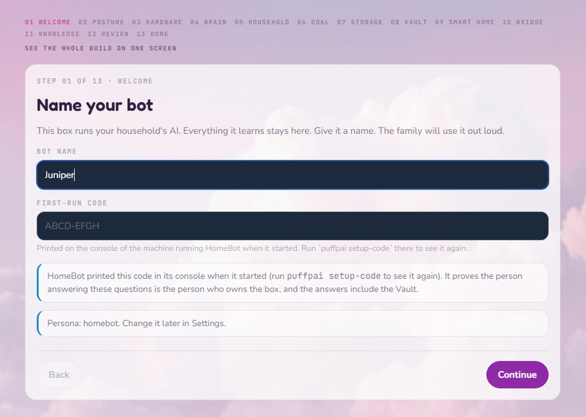
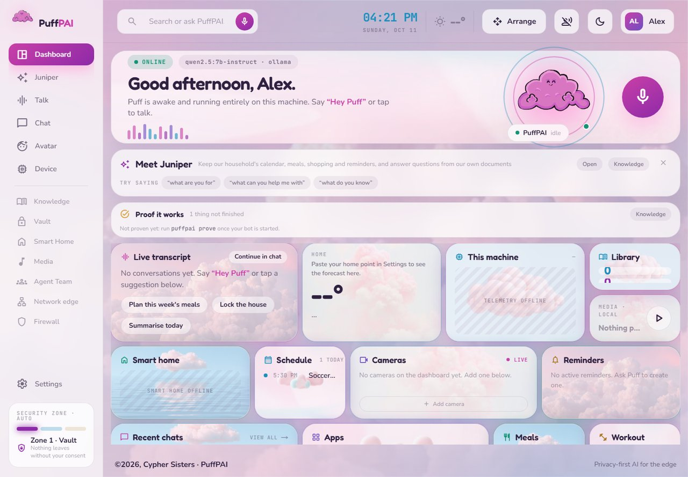
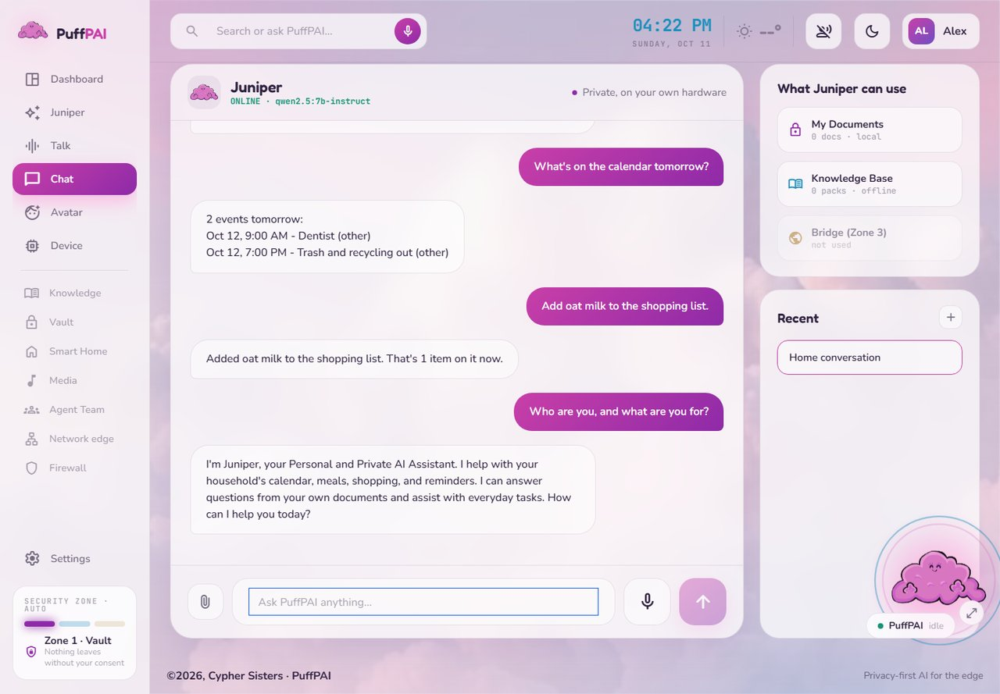

# HomeBotBuild: a private, offline-capable home AI for your Windows or Linux PC

**Your Hardware. Your Data. Your AI.**

HomeBot is a self-hosted, local AI assistant for your family and home that runs
on a Windows or Linux PC you already own (64-bit Windows 10/11 or Linux): a local LLM through Ollama, a
setup wizard that sizes the model to your machine, an offline knowledge library
read from Kiwix ZIM files, and optional Home Assistant control and voice
assistant. There is no cloud account and no subscription. Every registered
outbound connection has a name and a switch, and the Bridge ships closed; the
few exceptions are listed in [`docs/ARCHITECTURE.md`](docs/ARCHITECTURE.md)
section 9.3. It is part of
[PuffPAI](https://www.puffpai.com) by Cypher Sisters.

**You need:** a 64-bit Windows 10/11 or Linux PC, Python 3.10+, and
[Ollama](https://ollama.com/download). The wizard reads your hardware and picks
a brain that fits, instead of demanding RAM you do not have. Home Assistant,
voice, media and the network edge are all optional. On an NVIDIA Jetson AGX
Orin? See [Which repository](#which-repository).

## First use: emergency preparedness

A cloud assistant stops when the internet does. HomeBot works with the internet
off: once it is installed and has a model, chat, the apps, the knowledge library
and the wizard run on your own machine. How much it can do offline depends on
the build.

**An offline library you choose.** [`docs/KNOWLEDGE_PACKS.md`](docs/KNOWLEDGE_PACKS.md)
lists 66 Kiwix packs in ten groups, each with its official download, size and
license: medical reference (WikEM emergency medicine, MDWiki, field and military
medicine manuals), preparedness and self-reliance (Ready.gov in English and
Spanish, water purification, knots, food storage, post-disaster guides, the
Survivor Library), repair, home and food (iFixit, home improvement, car repair,
cooking), encyclopedias and reference (Wikipedia from a 6.5 GB best-of to the
118.7 GB edition with images, Wiktionary), travel (Wikivoyage, the
OpenStreetMap wiki), books, science, technology and more. Medical packs are
reference material, not medical advice.

Two ways to get them:

* **From the wizard.** The Sources card plans which packs to fetch and the
  Integrate card fetches them, after you confirm each one's license and size.
  Every request goes through the `knowledge_pack_downloads` Bridge switch,
  which ships shut like every other: open it on the Posture card or in
  Settings first. A Kiwix pack comes only from Kiwix's servers and official
  mirrors, following Kiwix's own redirect chain, and must match the sha256
  checksum Kiwix publishes for it, or nothing is installed. Anything big is
  left for later, with the command to fetch it.
* **By hand.** Download a pack from Kiwix, put the `.zim` file in your
  knowledge folder (`paths.zim_dirs`, set on the Storage card), and build its
  search index with `python -m puffpai.knowledge.fts_build_cli` (inside the
  venv). No switch is involved.

But it's built to be anything you want.

<p>



</p>

The wizard in the browser, the home page after setup, and a chat, taken on a
Windows test PC with a small local model (`qwen2.5:7b-instruct`) and nothing
else connected. The bot is called Juniper because that is what we named it.

## How this was built

We're two people, and we vibe coded the whole thing with AI coding tools
(Claude Code). It works, and we think it's awesome. The code is probably a hot
mess in places, and we'd love real coders and engineers to take a crack at it.

Where help is most welcome:

* **The failing tests.** The [Test status](#what-has-actually-been-run) paragraph
  names the groups they fall into. Fixing a group, or showing a test is wrong,
  is a great first pull request.
* **Hardware we do not have.** Only one real machine has run it (64 GB of
  RAM). Low-RAM laptops, AMD and Intel GPUs, other distros, and voice on
  Windows are all unproven.
* **The known exceptions** to "one way out", listed in
  [`docs/ARCHITECTURE.md`](docs/ARCHITECTURE.md) section 9.3 and pointed to from
  [`AGENTS.md`](AGENTS.md).
* **Reading the code and telling us what you'd change**: refactors,
  architecture, tests. Use the
  [code feedback](https://github.com/CypherSisters/HomeBotBuild/issues/new?template=code_feedback.md)
  issue, or [open any issue](https://github.com/CypherSisters/HomeBotBuild/issues/new/choose).

How to file an issue, send a pull request and run the tests:
[`CONTRIBUTING.md`](CONTRIBUTING.md). The system's promises and the contracts
that pin them: [`AGENTS.md`](AGENTS.md).

## Install and first run

**Minimum hardware:** 2 GB of RAM, the floor of the smallest model; below it
the wizard offers no model at all. At the floor the bot follows set phrasings
only. 8 GB fits a 7B model that handles one request per message, and the 30B
brain needs 24 GB (32 comfortable). A GPU is optional: the wizard sizes the
model by RAM alone. Disk: 1 to 19 GB for the model, plus the install, plus any
knowledge packs (from 9 MB to over 200 GB each). The only real machine we
have run it on has 64 GB, so nothing near the floor is proven yet. Details:
[`docs/HARDWARE.md`](docs/HARDWARE.md).

**The first install needs the internet**, for the Python packages, Ollama and a
model. After that, it does not. How long it takes is mostly download time:
the Python packages, the dashboard's npm packages, and a model of 1 to 19 GB.
We have not timed it on a clean machine.

**1. Get the code.**

```bash
git clone https://github.com/CypherSisters/HomeBotBuild.git
cd HomeBotBuild
```

**2. Run the installer.** It creates `venv/`, installs the packages, mints an
API key into your data folder, builds the dashboard, and looks for Ollama. It
never installs Ollama or downloads a model unless you ask
(`-YesInstallOllama`, `-Pull TAG` on Windows; `--yes-install-ollama`,
`--pull TAG` on Linux). Add `-DryRun` / `--dry-run` to see every command first.

```powershell
powershell -NoProfile -ExecutionPolicy Bypass -File install.ps1 -WithDashboard   # Windows
```
```bash
bash install.sh --with-dashboard                                                 # Linux
```

It ends with `Done. Activate the environment and run the wizard`. If it says
no Ollama was found, install it from [ollama.com](https://ollama.com/download)
before the wizard picks a model.

**3. Run the wizard** in the same terminal:

```powershell
.\venv\Scripts\Activate.ps1      # Windows
puffpai setup
```
```bash
source venv/bin/activate         # Linux
puffpai setup
```

It asks the questions in [What the wizard asks](#what-the-wizard-asks), one
card at a time, and ends with a Handoff that says how to start the bot and
lists every gap with the one command that fixes it. The Brain card proposes a
model sized to your RAM with its download size. The wizard downloads a model
only through the `model_pull` switch, which ships shut like every other, so
you either open it or run `ollama pull <model>` yourself.

**4. Start it.** Two terminals, both with the venv active:

```bash
python start_api.py                  # the backend, on 127.0.0.1:8000
cd dashboard && npm run start        # the dashboard, on http://localhost:3003
```

(On Windows PowerShell 5.1, write `cd dashboard; npm run start`.) Open
<http://localhost:3003>. At the end you have a local chat running a model sized
to your machine, the apps, the knowledge index and the three zones, with the
Bridge still closed. Then run `puffpai prove` for the live half of the proof.

**Prefer the browser?** Skip step 3, start both in step 4, and open the
dashboard: until setup is done it takes you to `/onboarding`, which asks the
same questions. It asks for the one-time setup code the backend printed on its
console when it started (`puffpai setup-code` shows it again).

### What has actually been run

A clean install has been done end to end in a Linux container
(`python:3.12-slim`, CPU only) and in a clean folder on one Windows 11 PC with
64 GB of RAM: installer, then the wizard. It has **not** been run on a second
real machine or on anything near the RAM floor, and **voice on Windows is
untested**.

**Test status.** The full suite at this release, split across 8 processes on
that Windows PC: 16,522 passed, **248 failed**, 133 skipped. The failures are
known, and fixing them is open work: the largest group is state-directory and
path handling (about 75, mostly `tests/test_statedir.py`), then 41 wizard API
tests that fail only when they run after certain other files (they pass on
their own and in the CI subset), then the planning loop (33). CI
runs a named subset on Linux with Python 3.10 and 3.12 (the wizard, setup API,
release contract, config and household tests) plus the dashboard type-check
and build, not the full suite.

Everything else in this README describes code that is here; where a claim is
thinner than that, it says so on the spot.

---

## What the wizard asks

The wizard is a run of cards. Each card proposes something from what it
measured, you accept or change it, and only then is it written. The terminal
run below is proven end to end. Full walkthrough:
[`docs/WIZARD.md`](docs/WIZARD.md).

| # | Card | What it asks |
|---|---|---|
| 1 | Posture | How much the bot may reach while you build and once it is built, and which Bridge switches that allows |
| 2 | This machine | Nothing, unless detection fails: it reports CPU, RAM, disk, GPU and where Ollama answers |
| 3 | Purpose | The bot's name and what it is for, in your words |
| 4 | Its place | Whether the bot gets a page of its own, the id it lives under, and the lists it keeps |
| 5 | The brain | A model sized to this machine's RAM, with the alternatives and their download size. It downloads only if you say yes and the posture allows it |
| 6 | The crew | Nothing: it shows the seven agents on this machine and who owns what |
| 7 | Surfaces | Which pages load. A page not on the list is not loaded at all |
| 8 | Household | Your name and who else lives here |
| 9 | The Vault | A PIN, twice. The recovery code is shown once and you type it back |
| 10 | Storage | Four folders: state, knowledge packs, the Vault, your media |
| 11 | Sources | What the bot should learn from. A plan only, nothing is downloaded |
| 12 | Integrate | Fetches what the plan chose, through the `knowledge_pack_downloads` switch. Anything big is left for later, with the command to fetch it |
| 13 | The Bridge | What the finished bot may reach, and what protects your network edge today |
| 14 | Home Assistant | Do you run one; its address and token, and the Zigbee hub |
| 15 | Tools | What the bot can reach for and what it cannot yet |

Then, with no questions: the build manifest is written; **Context** shows what
the bot was told about itself; **Prove** checks what was written (a persona
nothing can show, packs chosen and never downloaded, a start command that does
not exist); **Handoff** says how to start this install and lists every gap with
the one command that fixes it. Run `puffpai prove` once the bot is running for
the other half of the proof.

**Resume.** A setup that stopped part-way is offered back before the first
card: continue, and the Vault and the model are checked again first, or start
over, and the old record is kept beside the new one. `puffpai setup --yes`
never resumes.

**In the browser.** `/onboarding` walks the same build step by step, and
`/onboarding/review` shows the whole of it on one screen, one row per card with
its cost and status. **Build it** stays off until you have opened every row
that matters, and a total time it cannot know says "time unknown". The review screen opens in a browser but has not been walked end to end there.

Nothing is enabled that you did not choose. Voice and media are install extras
(`--with-voice`, the media compose file), not cards. The wizard comes from
[BuildBot](https://github.com/CypherSisters/PuffPAIBuildBot), our bot-building tool.

## The three zones

Every build ships all three. They are a contract about where data may go, not
three programs.

| Zone | Name | What it is |
|---|---|---|
| 1 | **The Vault** | Encrypted store for PII, secrets and personal context. PIN-gated; the AI has to ask. A turn that carries vault contents is never saved to chat history or shown on the wall panel. `src/puffpai/security/vault.py` |
| 2 | **The Brain** | Local models, the agent team, tool calls, the knowledge index. `src/puffpai/agents/`, `inference/`, `knowledge/` |
| 3 | **The Bridge** | The only zone that reaches outside. Named egress switches and the optional DNS sinkhole. `src/puffpai/security/egress_doors.py`, `zone3/` |

Seven master agents live in the Brain and the Bridge: Concierge, Steward,
Archivist, Majordomo, Caretaker, Toolsmith, and **Drawbridge**, the security
agent that gates what the others may do.

## What it does

| Area | What you get |
|---|---|
| Voice | Music dips for an addressed exchange, not for mere listening. "Stop" cuts a reply mid-sentence; the dashboard has a Tap to stop bar (`POST /voice/stop`). Optional two-pass check that the wake name was really said, and follow-ups that sound like a request, answered without the wake word. Spoken PINs and vault replies stay out of the voice journal |
| Dashboard | Live transcript of the spoken turn, reasoning in a side panel. Themes per profile (Cloud Pink, Deep Plum, Soft Light), a household page, a Skills page, a Books page, a calendar week view. The apps load their fonts and scripts from the machine, not a CDN |
| Knowledge | Big offline libraries (ZIM) browse like a website; whole books indexed in parts. "Search my documents for X" is answered from the upload index, and only documents that mention X count |
| Books | A librarian over your Calibre library: categories, shelves, "what do I have on X" |
| Home Assistant | The home blueprint: a floorplan with your devices on it and a traffic layer showing which ones talk out |
| Media | A Jellyfin playlist from a list you sent. Radio discovery with genre ranking and one household favorites list. TuneIn is its own Bridge switch, closed until you open it |
| Calendar | A delete by description removes only what matches and asks when two do; a bare hour ("before nine") resolves sensibly |
| Skills | A lost internet connection is reported as that, not as a broken skill |

## Optional integrations

Bring your own media, storage, vaults and edge security, or bring none of them.
Each absence greys out one surface and changes nothing else.

| Integration | Windows | Linux | What you need | What happens without it |
|---|---|---|---|---|
| Chat + dashboard | yes | yes | Node 20.19+ for the dashboard build (the CLI needs nothing) | this is the base |
| Apps (alarms, calendar, meals, FitFam, trivia) | yes | yes | nothing | n/a |
| Knowledge (documents, ZIM packs) | yes | yes | disk; `.[ocr]` + tesseract/poppler for scanned pages | image and scanned-PDF text comes back empty; typed documents still index |
| Home Assistant | yes | yes | an HA instance on your LAN and a long-lived token | house control is unavailable; HA cards report "not connected" |
| Voice (wake word, Whisper, speech-out) | partial | yes | a microphone; `.[voice]`; PortAudio on Linux | voice is off, everything else is unchanged. On Windows, Piper speech-out has no wheel, so output falls back to the browser voice |
| Media (Jellyfin, Calibre-Web) | Docker Desktop | yes | Docker, your own media directory | media search and playback report that no media server is configured |
| Automations (Node-RED) | Docker Desktop | yes | Docker | scheduled flows never fire; manual and voice actions are unaffected |
| Web search (SearXNG) | Docker Desktop | yes | Docker, and you opening its switch | `web_search` returns a structured "offline" answer |
| Zone 3 network edge | **no** | yes, opt-in | Docker, port 53 free, a LAN IP, and your router's DNS field | the Bridge page shows the network edge as not installed |
| Kiosk / wall display | yes | yes | a browser and a screen | n/a |

Windows bar: chat, dashboard, apps, and optional Home Assistant. Zone 3 is
Linux-only because it binds port 53 and is driven by systemd units.

## Install detail

* [`docs/INSTALL_WINDOWS.md`](docs/INSTALL_WINDOWS.md): flags, state directory, Task Scheduler, what voice does and does not do
* [`docs/INSTALL_LINUX.md`](docs/INSTALL_LINUX.md): flags, systemd user units, Zone 3, distro packages
* [`docs/INSTALL_ORIN.md`](docs/INSTALL_ORIN.md): the appendix for the Jetson AGX Orin appliance path (`scripts/install_orin.sh`)
* [`docs/HARDWARE.md`](docs/HARDWARE.md): minimum hardware, what each amount of RAM gets you, and what has and has not been tested
* [`.env.example`](.env.example): every Docker Compose variable, and what greys out when a container is absent

Extras, installed only if you ask: `voice`, `ocr`, `ml`, `zone3`, `dev`,
`desktop`, `orin`. [`setup.py`](setup.py) says what each one pulls and why it is
not in the base install.

## Storage and customization

State (config, vault, logs, the minted API key) goes to `$PUFFPAI_DATA_DIR`
when set, otherwise `%LOCALAPPDATA%\PuffPAI` on Windows and
`~/.local/share/puffpai` on Linux. Secrets live under your data dir, never in
the checkout. See [`docs/CONFIG.md`](docs/CONFIG.md).

Two exceptions, both in a **development checkout** and both git-ignored: a
checkout that has its own `data/` directory is used as the state dir so a dev box
does not write into the real one, and `dashboard/.env.local` holds a copy of the
API key because the dashboard is a separate process that has to authenticate to
the backend (the installer writes it; see `dashboard/.env.local.example`).

The Storage card asks for four directories and writes each to a config key, so
none of them has to live where the default put it
(`setup_ops.STORAGE_FIELDS`):

| What | Config key | Default |
|---|---|---|
| This build's own files (logs, indexes, state) | `paths.state_dir` | the data dir above |
| Knowledge packs (ZIM files) | `paths.zim_dirs` | under the data dir |
| The Vault's encrypted files | `paths.vault_data_dir` | under the data dir |
| Your media library | `media_server.media_mount` | empty; a build with no media library is a normal build |

| Environment | What it moves |
|---|---|
| `PUFFPAI_DATA_DIR` | the writable state root |
| `PUFFPAI_CONFIG_DIR` | where config files are read from (default `<repo>/config`) |
| `PUFFPAI_API_BIND` | backend bind address; default `127.0.0.1`. Widen it only for off-box Home Assistant, Node-RED in Docker, or a phone hitting the backend directly |
| `PUFFPAI_API_PORT` | backend port; default `8000` |
| `PUFFPAI_SETUP_STDIN_SECRETS` | `1` lets the wizard read secrets from stdin, for scripting an unattended setup |

Full reference, every key and variable: [`docs/CONFIG.md`](docs/CONFIG.md).

No avatar model ships; upload your own `.glb` and see what one needs:
[`docs/AVATARS.md`](docs/AVATARS.md).

Add your own documents, apps, skills and agent names on a running bot: [`docs/EXTENDING.md`](docs/EXTENDING.md).

## Privacy

Every registered outbound connection has a name and a switch, and the Bridge
ships closed. Each switch
has a fixed host list and a stated purpose, and one forced shut in the unit
file cannot be reopened from the UI:
[`docs/WHAT_CAN_LEAVE_YOUR_HOUSE.md`](docs/WHAT_CAN_LEAVE_YOUR_HOUSE.md)
(regenerate with `python scripts/gen_egress_doc.py`). That includes the
wizard's knowledge pack downloads (`knowledge_pack_downloads`) and model
downloads (`model_pull`). The known exceptions are listed in
[`docs/ARCHITECTURE.md`](docs/ARCHITECTURE.md) section 9.3.

Zone 3 ships inert twice over: nothing points at the resolver until you change
your router, and protection is off in the seeded configuration
(`docker-compose.zone3.yml`).

## Which repository

| Repository | Pick it when |
|---|---|
| **HomeBotBuild** (this one) | You want HomeBot on a Windows or Linux PC you already own (64-bit Windows 10/11 or Linux), installed by one command and set up by the wizard |
| [`CypherSisters/HomeBotFounders`](https://github.com/CypherSisters/HomeBotFounders) | You have an NVIDIA Jetson AGX Orin 64 GB and want HomeBot Founders Edition, the complete build installed and tuned for that board |
| [`CypherSisters/PuffPAIBuildBot`](https://github.com/CypherSisters/PuffPAIBuildBot) | You want to make your own private bot for something other than the home, on your own computer. BuildBot is the bot-building tool HomeBot's setup wizard comes from |

More about PuffPAI: [puffpai.com](https://www.puffpai.com).

## License

Apache-2.0. See [`LICENSE`](LICENSE), [`THIRD_PARTY_NOTICES.md`](THIRD_PARTY_NOTICES.md),
[`CONTRIBUTING.md`](CONTRIBUTING.md) and [`SECURITY.md`](SECURITY.md).
Security reports: GitHub private vulnerability reporting (see [`SECURITY.md`](SECURITY.md)).
