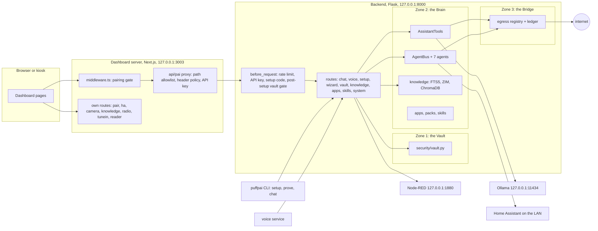
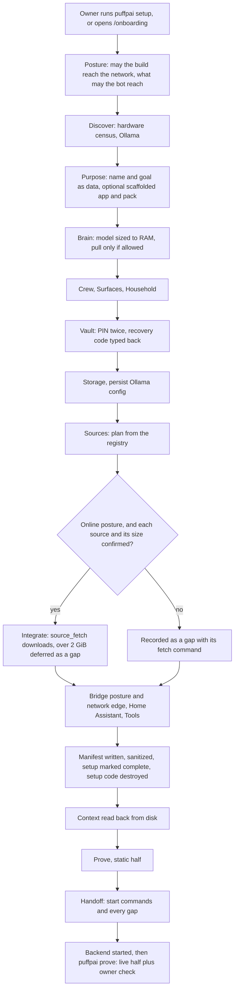
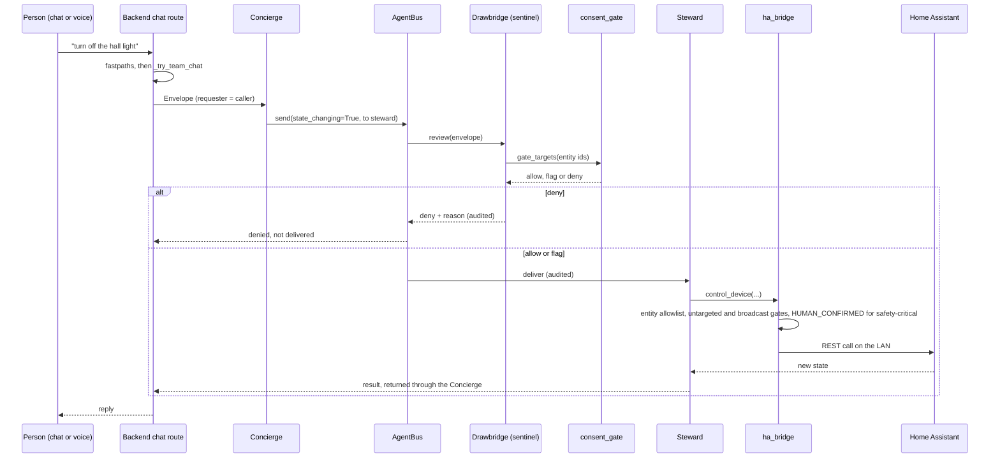
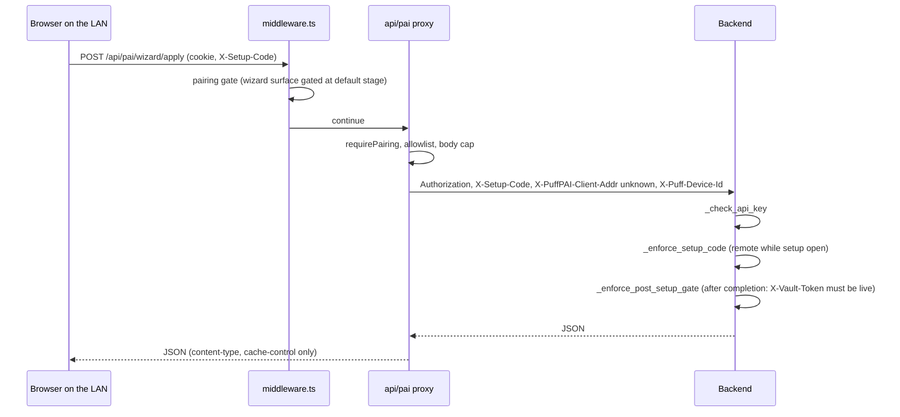

# HomeBotBuild reference architecture

How the pieces fit, where each lives in code, and which rules hold them
together. For the rules an agent must keep while changing the code, read
[`AGENTS.md`](../AGENTS.md) first; for install and use, the
[`README.md`](../README.md). File references are relative to the repository
root; `api_server.py` means `src/puffpai/api_server.py` (a single large Flask
module: search it for `@app.route('/<prefix>` to find a route).

## 1. The system in one paragraph

HomeBotBuild runs on one Windows or Linux PC. A Python backend (Flask) holds the
Brain (local models through Ollama, seven agents, tools, knowledge), the Vault
(encrypted personal data) and the Bridge (a registry of every outbound
connection, each with a switch, all shut by default). A Next.js dashboard is the
browser face; its server-side proxy is the only thing a browser talks to, and it
attaches the backend's API key and the caller's verified identity. A setup
wizard, vendored from BuildBot (the open-source base), turns the owner's stated
goal into a build and records every decision in a build manifest. Voice, media,
automations (Node-RED), web search (SearXNG) and the Linux network edge are
optional services.

## 2. Processes and ports

| Process | Start | Listens | Notes |
|---|---|---|---|
| Backend | `python start_api.py` (or `puffpai serve`, `puffpai-service`) | `127.0.0.1:8000` | `PUFFPAI_API_BIND` / `PUFFPAI_API_PORT` override; a non-loopback bind logs a warning every boot (`security/netaddr.py`) |
| Dashboard | `cd dashboard && npm run start` (`next start -H 127.0.0.1 -p 3003`) | `127.0.0.1:3003` | `npm run dev` for development; `instrumentation.ts` can open loopback proxies for Jellyfin (8096) and Calibre-Web (8083) when their LAN hosts are configured |
| Ollama | installed separately | `127.0.0.1:11434` | `ollama.url` in config or `PUFFPAI_OLLAMA_URL` |
| Voice (optional) | `python -m puffpai.voice.service` | none | Posts to `PUFF_BRAIN_URL` (default `http://127.0.0.1:8000/api/chat`) with its own `X-Puff-Device-Id`. The shipped `systemd/user/puffpai-voice.service` targets the appliance layout (`/opt/puffpai`); voice on Windows is untested |
| Node-RED (optional) | `docker-compose.nodered.yml` | `127.0.0.1:1880` | Automation engine; backend client `automation_client.py`, routes `/automation/status`, `/automation/trigger/<name>`, `/automation/flows` |
| SearXNG (optional) | `searxng/docker-compose.searxng.yml` | `127.0.0.1:8888` | Toolsmith's first hop for web search, behind the `web_search` switch |
| Jellyfin, Calibre-Web (optional) | `docker-compose.media.yml` | `${PUFFPAI_BIND_IP}:8096`, `:8083` | Media library mounted read-only |
| Zone 3 edge (optional, Linux) | `docker-compose.zone3.yml` | `${PUFFPAI_BIND_IP}:53`, `:3000` | AdGuard Home, protection off in the seed config |
| ChromaDB | in-process (`chromadb.PersistentClient`, `knowledge/rag.py`) | none | Embedded, not a server |

On Linux, `install.sh --with-services` writes systemd user units for the
backend and dashboard (written, enabled only with `--enable`). On Windows,
`install.ps1 -WithStartup` prints a Task Scheduler recipe and creates nothing.



## 3. Per-user state

Nothing is written into the checkout on a normal install. The state root is
`$PUFFPAI_DATA_DIR` when set, otherwise the per-user data directory
(`platform_paths.user_data_dir`):

* Windows: `%LOCALAPPDATA%\PuffPAI`
* Linux: `$XDG_DATA_HOME/puffpai`, else `~/.local/share/puffpai`

The installers write `PUFFPAI_DATA_DIR` into `<state>/homebot.env`, which the
backend loads at start (`envfile.py`). `config.resolve_state_dir` picks, in
order: an absolute configured path, `$PUFFPAI_DATA_DIR/<subdir>`, a relative
configured path under the repo, then the per-user directory. The one exception
is a development checkout that already holds runtime state in `<repo>/data`,
which keeps using it (logged once). `config._config_dir_for` resolves the
config directory the same way: `$PUFFPAI_CONFIG_DIR`, else `<state>/config`
seeded from the shipped `config/*.json`, else `<repo>/config` in a dev checkout.

```
<state>/
  homebot.env                  API key (+ PUFFPAI_DATA_DIR), 0600 on POSIX
  config/                      puffpai_config.json, home_assistant_config.json,
                               build_manifest.json, wizard_run.json, profiles.json
  data/                        setup_state.json (complete flag), setup_code.json,
                               setup_pending_apply.json
  state/                       egress_doors.json (switch overlay),
                               egress_policy.json, zone3_enforce.json
  apps/  packs/                the owner's own app and pack manifests
  app_data/                    one JSON store per app
  skills/                      installed skills and drafts
  vault_data/                  the Vault's encrypted files (paths.vault_data_dir)
  security_logs/               egress.jsonl (ledger), audit trail
  logs/                        rotating backend log
  kiwix_rag_db/  chat_history/ uploads/  user_memory/  avatars/ ...
```

The four owner-facing locations (state, knowledge packs, the Vault, media) are
chosen on the wizard's Storage step (`setup_ops.STORAGE_FIELDS`:
`paths.state_dir`, `paths.zim_dirs`, `paths.vault_data_dir`,
`media_server.media_mount`). `config.get_state_dir` (`$PUFFPAI_STATE_DIR`, else
`<state>/state`) is read only by `prove_cli.py` for a legacy key file.
The dashboard keeps its pairing state in `dashboard/data/` (`PUFF_PAIRING_STATE`
overrides) and its copy of the API key in `dashboard/.env.local`; both are
git-ignored.

Per-person state inside one install: household members live in `profiles.json`
(`profile_manager.py`, `household.py`); per-user views and memory are behind
`PUFFPAI_MULTIUSER` (off by default); vault-unlocked chat sessions are keyed per
device (section 8).

## 4. The three zones in code

| Zone | Promise | Where it lives |
|---|---|---|
| **The Vault** | Personal data encrypted at rest, PIN-gated, kept out of chat history and the model's memory | `security/vault.py` (`Vault`: AES-256-GCM, random 32-byte data key wrapped under an scrypt key from the PIN, recovery code as a second wrap, sessions expire after 15 minutes idle), `zone_vault.py` (wizard ceremony), `security/scrub_and_vault.py`, `security/pii_classifier.py`, `security/vault_view.py`, `security/ha_vault.py`, the `/vault/*` routes |
| **The Brain** | Local inference and orchestration; works offline | `agents/`, `assistant_tools.py`, `inference/`, `knowledge/`, `capability_registry.py`, `app_registry.py`, `skills/`, `build_context.py` |
| **The Bridge** | The only way out; every way out named and switched; ships closed | `security/egress_doors.py` (registry), `security/egress_ledger.py`, `security/egress_policy.py`, `security/egress_admin.py`, `zone_bridge.py` (wizard posture), `zone3/` (optional edge) |

`security/zones.py` numbers zones by sensitivity (`VAULT = 1`,
`INTELLIGENCE = 2`, `NETWORK_EDGE = 3`); the product names are the Vault, the
Brain and the Bridge. The manifest's `contracts` block states the invariants
every build inherits (vault, human-only consent, action gates, no telemetry) and
is regenerated on every write (`build_manifest._CONTRACTS`).

## 5. The wizard

### 5.1 Steps

The engine is `wizard/runner.py`. Twelve BuildBot skills
(`runner.SKILL_ORDER`: discover, purpose, brain, sources, tools, integrate,
context, crew, secure, surfaces, prove, handoff) live as packages in
`wizard/packages/<id>/` (`manifest.json` + `skill.py`). The order they run in is
`runner.SCHEDULE`; `wizard/host.setup_schedule()` inserts this build's three
uncarded steps for the terminal run. The terminal order:

| # | Entry | Owner | Writes |
|---|---|---|---|
| 1 | `secure.posture` | secure | posture, `egress_doors` in config |
| 2 | `discover.card` | discover | machine census, Ollama location |
| 3 | `purpose.identity` | purpose | name, goal (interview) |
| 4 | `purpose.place` | purpose | optional scaffolded app + pack in `<state>/apps`, `<state>/packs` |
| 5 | `brain.card` | brain | model choice; pulls only if the posture and `model_pull` allow |
| 6 | `crew.card` | crew | crew section (the seven agents on this machine) |
| 7 | `surfaces.card` | surfaces | surface allowlist |
| 8 | `runner.household` | host | `profiles.json` |
| 9 | `secure.vault` | secure | sealed Vault; recovery code shown once and typed back |
| 10 | `runner.storage` | host | `paths.*`, `media_server.media_mount` |
| 11 | `runner.persist_config` | runner | `ollama.model`, `ollama.url` |
| 12 | `sources.card` | sources | knowledge plan (no download) |
| 13 | `integrate.card` | integrate | fetches confirmed sources, records what landed |
| 14 | `secure.bridge` | secure | run posture, network-edge answer, `pending_apply` |
| 15 | `runner.home_assistant` | host | `home_assistant_config.json` |
| 16 | `tools.card` | tools | tools section |
| 17 | `runner.wrote_paths` | runner | prints what was written |
| 18 | `runner.manifest` | runner | `build_manifest.json`; marks setup complete |
| 19 | `context.card` | context | reads back what the bot is told about itself |
| 20 | `prove.check` | prove | static proof record |
| 21 | `handoff.card` | handoff | closing screen, gaps and their fix commands |

Runner rules (`runner.py` docstring, `wizard/manifest.py`, `wizard/cards.py`):
one writer per section, and a result for any other section is refused;
reserved sections (`run`, `posture`, `egress`, `brain`, `prove`) may only be
written by packages shipped in the tree (decided by folder location, never by a
manifest claim); only Brain and Secure may stop a build, anything else records a
gap; `SetupRefused` propagates; the run state (`<config>/wizard_run.json`) is
scrubbed of secret keys and values after every entry; a card is plain data and a
`secret_entry` field never carries a value. A stopped run can be resumed within
a week (`find_stopped_run`), with the Vault and the model re-verified;
`--yes` never resumes.

### 5.2 One engine, two faces

* **Terminal**: `puffpai setup` goes `cli._cmd_setup` to
  `wizard/host._run_setup`, which builds a `Runner` over `setup_schedule()` and
  renders cards with `wizard/render_cli.py`.
* **Browser review**: `/onboarding/review` calls `GET /wizard/cards`,
  `POST /wizard/apply`, `POST /wizard/run`, `GET /wizard/state`,
  `POST /wizard/resume`, which are thin wrappers over `wizard/service.py`
  (`propose_cards`, `apply_skill`, `run_rest`, `run_state`, `resume_offer`).
  It runs the same packages and the same `Runner` over `runner.SCHEDULE`
  (row order comes from the server), one run at a time (`wizard_run.lock`).
  Proposing is read-only.
* **Browser step-by-step**: `/onboarding` (`dashboard/app/onboarding/OnboardingWizard.tsx`)
  calls the `/setup/*` routes through `setupService.ts`. Those routes call the
  same `setup_ops` functions the packages call (for example
  `setup_ops.seal_vault_with_recovery`, `persist_posture`, `fetch_source`), so
  there is one implementation of each action.
* The three host steps (storage, household, Home Assistant) are on the terminal
  schedule and on the `/setup/*` pages, not on the review screen.

### 5.3 The manifest

`build_manifest.py` (schema `build_manifest/v2`) at `<state>/config/build_manifest.json`.
Sections: `build` (based on `homebotbuild`, identity, name), `hardware`,
`brain`, `crew`, `storage`, `knowledge`, `egress`, `integrations`, `posture`,
`surfaces`, `provenance`, `contracts`, and `config_health` when a shipped
config was corrupt. `write_manifest` always runs `sanitize_manifest`, which
strips `_FORBIDDEN_KEYS` (anything that looks like a switch for a contract:
`disable_vault`, `bypass_consent`, `allow_all_egress`, `telemetry`, ...) and
`_SECRET_KEYS` wherever they appear, and regenerates `contracts`.
`diff_manifest` shows changes before a rewrite. No manifest field is ever an
instruction to the model: `build_context.system_prompt` sanitizes owner text
and places it in a data block, with the persona from `persona.txt`
(`{ai_name}` placeholder) first and the owner's own instructions last.

### 5.4 Proving a build

* **Static half**, inside the wizard: `prove.static_prove()` via
  `wizard/packages/prove/skill.py`. No server, model or network: it checks
  what was written (reserved persona id, a persona nothing can show, packs
  chosen but never downloaded, a start command that does not exist here).
* **Live half**: `puffpai prove` (`prove_cli.py`, `prove_live.py`) calls the
  running backend over HTTP (`GET /persona/list`, `GET /knowledge/sources`, at
  most three `POST /chat/send`), grades only whether the bot knows its name,
  and asks the owner whether the bot is in the dashboard menu (confirmed,
  refuted or unproven). Routes: `POST /build/prove/static`, `/build/prove/live`,
  `/build/prove/owner`, `GET /build/prove`. A failed proof does not block
  Handoff; it is shown until it passes.



## 6. Agents and the action flow

The roster is `agents/registry.ROSTER`; `build_team()` wires every agent onto
one `AgentBus` and designates `sentinel` as reviewer. Display names come from
`agents/preferences.py` and are cosmetic; code routes on ids.

| Id (display) | Role | File |
|---|---|---|
| `concierge` | front desk and routing; holds no secrets | `agents/concierge.py` |
| `steward` | house actuators and media, through `ha_bridge` | `agents/steward.py` |
| `sentinel` (Drawbridge) | policy review (the veto), device watch | `agents/sentinel_agent.py` |
| `archivist` | knowledge and Vault-scoped retrieval, PII quality gate | `agents/archivist.py`, `pii_quality_gate.py` |
| `majordomo` | schedules and task queue; `dispatcher.py` consumes it | `agents/majordomo.py` |
| `caretaker` | system health and repairs | `agents/caretaker.py` |
| `toolsmith` | web and workspace tools; reads untrusted text, holds no household credential | `agents/toolsmith.py` |

Guarantees at the bus (`agents/bus.py`, `agents/envelope.py`): every envelope
names its requester and origin; `state_changing=True` envelopes go to
`sentinel.review` before delivery, and a missing reviewer, a crashing review or
an unrecognised verdict is a deny; `Budget` caps actions and time and defaults
`allow_egress=False`; every send, veto and abort is audited with payload keys
only. `SentinelAgent.review` collects the target entities, runs
`consent_gate.gate_targets` (per-device consent, default pending; blast-radius
cap `PUFFPAI_MAX_BLAST_RADIUS`; safety-critical domains), refuses quarantined
devices, reviews LLM-authored automations, and denies egress the budget does
not allow. On the bus a deny always blocks; `PUFFPAI_ENFORCE_CONSENT` governs
only the separate automation-creation path's dry-run mode.

Below the bus, `ha_bridge.py` is the only Home Assistant client: entity ids are
allow-listed, untargeted and broadcast service calls are refused, and
safety-critical domains (`siren`, `lock`, `alarm_control_panel`, `cover`,
`valve`, `water_heater`, `camera`) need the in-process `HUMAN_CONFIRMED` token,
which no JSON body can supply. Consent requests
(`security/consent_requests.py`) are filed by flows that need a person's yes
(HA provisioning, Zigbee pairing, adding a camera, installing a skill) and are
closed by `POST /sentinel/consent/requests/<id>` (explicit `approve`
required) or by chat tools that can act only on an already-open request.



## 7. Chat and voice paths

* **Typed chat**: `POST /chat/send` and `POST /chat/stream` (also
  `/v1/chat/completions` and `/api/chat` for OpenAI- and Ollama-shaped clients,
  loopback or key only). Each turn: `_prepare_user_message` opens the per-turn
  records and screens PII (by default the local model sees the message and
  history stores the redacted text; with `PUFFPAI_SCRUB_AND_VAULT=1` and a
  recovery code set, handles replace PII for the model too); a pure PII
  disclosure is answered deterministically; then `_process_chat_query`:
  compound split, instant answers and app fastpaths, document search, then by
  route: the agent team (`_try_team_chat`, `_route_via_concierge`), direct
  handlers, the LangGraph tool agent (`AssistantTools.run`, tools bound by
  `capability_registry.tools_for_query`), the library, or RAG
  (`_query_ollama_direct`). Replies pass `_guard_chat_reply` and
  `_apply_pii_honesty`; a turn marked vault-private is not saved and the
  response says `private: true` so the client does not save it either.
* **Voice**: the voice service (`voice/service.py`: wake word, VAD, Whisper or
  Vosk STT, Piper TTS) posts to `/api/chat`, which runs
  `_process_voice_query` (short spoken replies, `PUFF_VOICE_*` limits).
  Spoken PINs and vault replies stay out of the voice journal
  (`voice/log_privacy.py`). `/voice/stop`, `/voice/state`, `/voice/live` serve
  the dashboard's controls.
* **Vault in chat**: a protected question triggers a PIN challenge; a correct
  PIN opens a 300-second window keyed by `_get_chat_client_id` (section 8).
  Tools that can return vault content are listed in
  `assistant_tools.VAULT_PRIVATE_TOOLS`; any turn that runs one is private.
* **Persona and context**: `persona.txt` with `{ai_name}` (shipped assistant
  name "PuffPAI", renamed by the wizard's identity step) plus
  `build_context.system_prompt`.

## 8. Dashboard, proxy and identity

Browser code never holds the API key. It calls same-origin `/api/pai/<path>`
through typed clients in `dashboard/app/_lib/services/` (for example
`chatService.ts`, `wizardService.ts`, `setupService.ts`,
`automationService.ts`).

**Pairing** (`dashboard/app/_lib/server/pairing.ts`, `middleware.ts`): a device
redeems a household pairing code (`POST /api/pair`, same-origin, rate-limited)
for a signed `puff_device` cookie tied to a device registry entry. The first
code comes from an already-paired device (`GET /api/pair/code`) or
`node scripts/show-pairing-code.js` run in `dashboard/`. `PUFF_PAIRING_ENFORCE`:
`off`, `knowledge` (default: knowledge writes, the whole `/api/pai/wizard`,
`/api/pai/build/prove`, `/api/pai/build/self` surface including reads, and
persona writes), or `all` (every proxied route). An upload-scoped device token
may satisfy the gate for `POST /api/pai/knowledge/upload` only.

**The proxy** (`app/api/pai/[...path]/route.ts`): pairing check again
(`requirePairing`), refuse encoded separators, then
`proxyAllowlist.PROXY_ALLOWED_PREFIXES` (404 for anything else), a 50 MB body
cap, and headers from `proxyHeaders.upstreamHeaders`:

| Header upstream | Source | Scope |
|---|---|---|
| `Content-Type`, `Accept` | client | all |
| `X-Vault-Token` | client | `vault/*`, `setup/*`, `wizard/*`, `persona/*` |
| `X-Setup-Code` | client | `setup/*`, `wizard/*`, `persona/*`, `build/prove*`, `build/self*` |
| `X-PuffPAI-Client-Addr` | server, always `unknown` | all |
| `X-Puff-Device-Id` | server, HMAC of the verified cookie's device id | when the cookie verifies |
| `X-Puff-Anonymous: 1` | server | when it does not (exactly one of the two) |
| `Authorization: Bearer <key>` | server env `PUFFPAI_API_KEY` | all |

Nothing else crosses: no cookies, no client copy of the identity headers, no
`X-Forwarded-*`. Only `content-type`, `cache-control` and
`content-disposition` come back (plus a sandbox CSP on the knowledge asset
route).

**Backend side** (`api_server.py`): `_get_chat_client_id` believes
`X-Puff-Device-Id` only when the socket peer is loopback or listed in
`PUFFPAI_TRUSTED_PROXY_IPS`; `X-Puff-Anonymous` (or a missing or malformed id)
from a trusted peer gets a fresh single-use `anon:` key and no vault answers;
any other caller is keyed `peer:<address>`. `_setup_client_is_local` treats a
request as local only when the peer is loopback and `X-PuffPAI-Client-Addr` is
absent or a loopback address, so every browser through the proxy counts as
remote for the setup code.

**Setup code path**: while setup is incomplete, `setup_code.current()` mints a
code shown on the console (`host.pairing_block_lines`, `puffpai setup-code`).
The browser sends it as `X-Setup-Code`; `_enforce_setup_code` checks it with
`hmac.compare_digest`, locks out and rotates after five misses, and never
echoes it. `setup_ops.mark_complete` writes the complete flag and destroys the
code; from then on `_enforce_post_setup_gate` and `_setup_gate` require an
unlocked vault session for writes.



The dashboard server also has its own routes that do not go through the keyed
proxy: `/api/pair/*`, `/api/ha/*` and `/api/camera/*` (Home Assistant on the LAN
with a server-side token), `/api/knowledge/source|asset` (loopback backend
reads), `/api/health`, `/api/system/stats`, `/api/media/status`, and the
outbound `/api/radio/*`, `/api/tunein/*` and `/api/reader` (section 9.3).

## 9. Egress: the Bridge

### 9.1 The registry

`security/egress_doors.py` enumerates every built-in way out in `DOORS`
(seventeen entries): `weather`, `air_quality`, `news_rss`, `geocode`, `geoip`,
`radio_browser`, `tunein`, `web_search`, `web_fetch`, `page_reader`,
`tv_free_channels`, `map_data_updates`, `knowledge_pack_downloads`,
`connectivity_probe`, `model_pull`, `embedding_model_download`, `spotify`. Each names its hosts, its
purpose, what leaves the house, its config flag and `PUFFPAI_EGRESS_*`
variable, and `default=False`. Apps add `app:<app_id>:<n>` entries from their
manifests (`register_app_doors`) and approved skills add `skill:<id>:0`,
keyed to a digest of the approved host set.

A switch resolves (`_resolve_flag`) from, in order: environment (an operator
forcing it; the UI cannot override), the owner overlay
`<state>/state/egress_doors.json` (written by `POST /system/egress/door`),
`egress_doors` in the config (written by the wizard's posture step), then the
default. An unreadable overlay shuts everything; a junk value is shut.
`GET /system/status` publishes each entry's state and source.

`egress_request` refuses a shut switch before DNS, refuses an undeclared host,
https and port 443 only, resolves the name and refuses any private, loopback,
link-local or otherwise non-public answer, pins the connection to the checked
address, re-validates every redirect, and records the decision in
`security_logs/egress.jsonl` (`security/egress_ledger.py`: host, path, bytes;
never a query string, body or token; rotated). Some call sites use libraries
that open their own sockets and instead ask `egress_allowed`/`require_open`
first: `assistant_tools.web_search` and `agents/toolsmith.py` (`web_search`,
`web_fetch`, which also requires the envelope budget), `brain_health.pull_model`
(`model_pull`), `embeddings._chroma_default_ef` (`embedding_model_download`),
and `tv_cast._relay_get` and `tv_player.play_free` (`tv_free_channels`, which
record player starts and relayed hops with `record_external`; within one cast
the relay writes each host and outcome once, then at most once every 10
minutes with a count of the hops in between).
`offline_guard.has_internet` probes only hosts of switches already open
(`connectivity_probe` is derived). Settings that are not ways out, such as
`agents.chat_allow_egress`, live in `security/egress_policy.py` with their own
overlay; they only decide who may use an open switch.

### 9.2 What ships closed

The shipped `config/puffpai_config.json` has no `egress_doors` section and
`web_search_consent: false`, so every entry resolves shut on a fresh install
(`tests/test_release_doors_shut.py`). The owner opens switches on the wizard's
posture step or in Settings. [`docs/WHAT_CAN_LEAVE_YOUR_HOUSE.md`](WHAT_CAN_LEAVE_YOUR_HOUSE.md)
is generated from the registry by `scripts/gen_egress_doc.py`.

### 9.3 Outside the registry, stated exactly

* **`spotify`** is enumerated but not gated: its switch does not stop the call.
* **Dashboard server routes** `/api/radio/search`, `/api/radio/click/<uuid>`
  (radio-browser), `/api/tunein/search`, `/api/tunein/resolve` (TuneIn) and
  `/api/reader` (fetches a page the browser names, public addresses only) make
  outbound requests from the Next.js process without consulting the registry,
  and the browser plays radio streams directly. The guard tests scan Python
  only.
* **Containers**: Node-RED flows, librespot and SearXNG's upstream engines make
  their own connections, and so does the kiosk TV player once
  `tv_free_channels` lets a free channel start. The start is in the ledger;
  the container then follows the playlist's redirects and segments with no
  address check, no https check and no ledger line, so a playlist could point
  it at a device on the house network (the cast relay checks every hop). The
  Zone 3 resolver forwards lookups to Quad9 when it is enabled and the router
  points at it.
* **Jellyfin** fetches internet channels itself when a household adds an
  internet IPTV tuner to its Live TV, and its metadata and plugin downloads go
  out when they are turned on in Jellyfin. `tv_free_channels` does not control
  Jellyfin-carried channels.
* **Ollama** itself downloads models when asked; the wizard asks only with
  `model_pull` open and otherwise prints the manual command.

## 10. Knowledge

* **Sources registry**: `source_registry.py` loads `config/source_registry.json`
  (`source_registry/v1`), drops unlicensed rows, matches rows to the goal with
  cited terms. `source_fetch.py` is the only mover of bytes. The Integrate
  card (`wizard/integrate_fetch.run_fetches`, `setup_ops.fetch_source`,
  `source_fetch.fetch_registry_pack`) downloads the sources the owner picked, only for rows
  in `config/source_registry.json`, only when the posture allows online
  sourcing, only after the owner confirmed each source's license, address and
  size, and only with the `knowledge_pack_downloads` switch open. Every hop goes
  through `egress_request` (pinned, ledgered). A Kiwix pack may follow only
  Kiwix's chain (`download.kiwix.org`, `lb.download.kiwix.org`, one official
  mirror serving the same path), and is checked against the `.sha256` Kiwix
  publishes before it is installed. A confirmed download of a Kiwix pack row
  does not read robots.txt: one download of a file the registry names is not
  crawling, Kiwix's own apps download from the same server, and
  `download.kiwix.org` disallows every path. That skip is written to the egress
  ledger (kind `robots_skipped`) and to the pack's provenance record. Every
  other row, and `source_fetch.fetch` for any address, honours robots.txt and
  refuses when it cannot read it. A provenance record is written beside each
  file; sources over 2 GiB are deferred as a gap with their fetch command.
  `knowledge/build_sources.py` reconciles what was promised with what is on
  disk (`GET /knowledge/sources`).
* **ZIM**: `knowledge/zim_reader.py` reads ZIM files directly (no kiwix-serve);
  `knowledge/discovery.py` finds packs in `paths.zim_dirs`;
  `knowledge/zim_links.py` rebuilds article HTML from an allowlist before the
  browser sees it.
* **Full text**: `knowledge/fts_index.py`, one SQLite FTS5 shard per ZIM
  (`paths.fts_dir`, default a sibling `fts` directory), built by
  `python -m puffpai.knowledge.fts_build_cli`; `knowledge/shard_browse.py`
  pages libraries from the shard. Routes `/knowledge/search*`,
  `/knowledge/library/*`.
* **Vectors**: `knowledge/rag.py` (`DualZoneRAG`, embedded ChromaDB at
  `paths.chromadb_path`), embeddings from `embeddings.py` (default ChromaDB's
  ONNX model, fetched once behind `embedding_model_download`).
* **Documents**: `POST /ingest/upload` and `/knowledge/upload` go through
  `ingestion.py`: extract text (OCR with the `ocr` extra), screen for PII
  (`security/pii_classifier.py`), move sensitive values into the Vault and index
  the redacted text; high or critical PII with a locked vault raises
  `PiiVaultRefusal` and nothing is indexed. `upload_index.py` reads both upload
  stores so every search route sees the same documents.

## 11. Apps, packs and skills

* **Apps** (`app_registry.py`, schema `puffpai_app/v1`): a folder with
  `app.json`, scanned from `apps/` (shipped, first) and `<state>/apps` (owner).
  A manifest is data: validated, bounded, never imported or executed; declared
  keywords feed the router, `data.default` seeds the store in `app_data/`,
  `ui.route` names the page (`/dashboard/apps/<id>` for generic apps), declared
  hosts become `app:<id>:<n>` switches. Installing is rescanning
  (`POST /apps/rescan`, `puffpai apps rescan`; the registry also notices new
  folders by fingerprint). Shipped apps: alarmflow, calendar, fitfam,
  freshtable, trivia.
* **Packs** (`puffpai_pack/v1`): a named bundle of installed apps
  (`packs/homebot/pack.json`); no data or code.
* **Personas**: `persona_scaffold.py` writes one app and one pack from the
  owner's words (`puffpai persona new`, `POST /persona/scaffold`, the wizard's
  place step), validated before writing, into the owner's directories.
* **Skills** (`skills/`): three files submitted as a draft
  (`POST /skills/drafts`, `puffpai skills submit`), linted, run against their
  fixtures in a bubblewrap jail with no network namespace, shown to the owner
  byte for byte with a sha256 per file, and installed only when the owner
  approves the consent request (`skills.install.apply_approved_install`). At
  run time `skills/dispatch.run` re-checks hashes and the kill switch; the only
  way out is `skills/broker.py` through the skill's own switch. Without
  `/usr/bin/bwrap` (including Windows) skills install switched off.

## 12. The capability registry

`capability_registry.py` declares each capability once: id, domain, label, one
authority tool, data source, access, related tools, keywords, owning agent,
surfaces, `dispatch_phrases` (empty means never auto-dispatched) and an honest
status (`live`, `needs-auth`, `offline`, `planned`). It drives tool binding
(`AssistantTools._filter_tools_by_intent` via `tools_for_query`), capability
reads, "what can you do" answers and `GET /capabilities/extend`. Installed
skills add rows through `set_skill_overlay`. `validate(live_tool_names)`
reports declared tools that do not exist and agents off the roster.

## 13. The network edge and the optional firewall backend

* **Posture** (`zone_bridge.py`, `build_posture.py`): the wizard records how
  much the build and the finished bot may reach, and what already protects the
  network edge (nothing, Zone 3, or the owner's own gear). The answer is data;
  picking Zone 3 applies nothing and writes the commands to
  `setup_pending_apply.json`.
* **Zone 3** (Linux, Docker, opt-in): AdGuard Home from
  `docker-compose.zone3.yml`, `zone3.enabled` false in the shipped config,
  monitor-first; blocking resolves from `PUFFPAI_ZONE3_ENFORCE`, then the
  overlay, then config. See [`docs/ZONE3_SETUP.md`](ZONE3_SETUP.md).
* **Firewall backend** (`firewall_manager.get_firewall_backend`): on Linux the
  default is `UnavailableFirewall`, which refuses every write with a 501; the
  nftables backend is selected only when `PUFFPAI_FIREWALL_BACKEND=nft` (or
  `nftables`) is set, and it can write rules only if the process also has
  `CAP_NET_ADMIN`. No host packet filter
  is installed or enabled by this build. On Windows the `/firewall/*` write
  routes call `netsh advfirewall` when invoked; nothing is changed at install.
  These routes sit behind the API key, not the agent bus.

## 14. Storage summary

| Data | Store | Code |
|---|---|---|
| Vault items and documents | encrypted files in `paths.vault_data_dir` | `security/vault.py` |
| App lists | JSON per app in `app_data/` | `app_data.py`, `security/app_data_store.py` |
| Chat history | JSON under `paths.chat_history_dir`, redacted, vault-private turns omitted | `api_server.py` (`_save_conversation`) |
| Knowledge | ZIM files, FTS5 shards, ChromaDB, document registry | `knowledge/` |
| Build record | `build_manifest.json`, `wizard_run.json` | `build_manifest.py`, `wizard/runner.py` |
| Switch state | `state/egress_doors.json`, `state/egress_policy.json` | `security/egress_admin.py` |
| Audit and egress trail | `security_logs/` JSONL, rotated | `security/audit_log.py`, `security/egress_ledger.py` |
| Consent | consent ledger and open requests (JSON) | `security/consent_gate.py`, `security/consent_requests.py` |
| Pairing | `dashboard/data/pairing.json`, device registry | `dashboard/app/_lib/server/pairing.ts` |

## 15. Security model and trust boundaries

* **Boundary 1, the machine**: anyone who can read the state directory can read
  the API key and the setup code; that is out of scope. Secrets are 0600 on
  POSIX and inherit the profile ACL on Windows.
* **Boundary 2, loopback plus API key**: the backend binds loopback and
  requires the key on every non-public route. A local process with the key is
  trusted and may assert a device id; it still cannot land in another device's
  vault session without its 128-bit derived id.
* **Boundary 3, the dashboard**: binds loopback by default. When exposed to the
  LAN, pairing decides who and the proxy allowlist decides what; the proxy
  never lends identity or locality to a client.
* **Boundary 4, first run**: the console setup code stands between the network
  and an unfinished build; the vault gate stands in front of a finished one.
* **Boundary 5, agents and models**: model output, manifest fields, app
  declarations, fetched content and knowledge text are data. State changes pass
  the bus veto and the HA gates; consent comes only from a person; the
  Toolsmith, which reads the web, holds no household credential
  (`security/secrets_provider.AgentScope`).
* **Boundary 6, the Bridge**: every registered way out is named and switched
  and ships closed, with the exceptions in section 9.3.
* Configuration that widens trust: `PUFFPAI_API_BIND`,
  `PUFFPAI_TRUSTED_PROXY_IPS`, `api_server.trusted_proxy_hops`,
  `PUFFPAI_TRUSTED_LOCAL_PEERS`, `PUFF_PAIRING_ENFORCE=off`. Each is off or
  loopback by default. Reporting: [`SECURITY.md`](../SECURITY.md).
